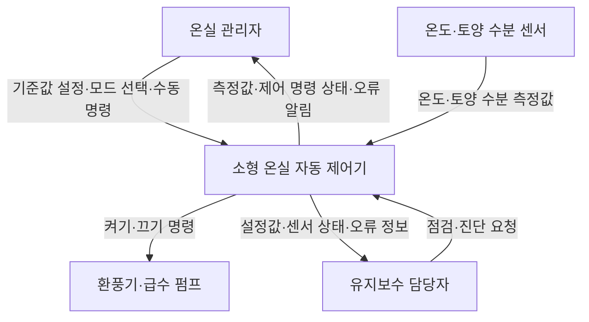

이 과제는 **제어기 하나를 정한 뒤, 무엇을 개발하고 누구와 연결되며 얼마나 많은 작업이 필요한지 정의하는 과제**입니다.

아래는 **「소형 온실 자동 제어기 개발 프로젝트」**를 주제로 작성한 과제 예시입니다. 교수님이 대상 제어기를 따로 지정했다면 주제를 바꿔야 합니다. 인원·기간·예산 상한·성능 목표는 **과제 작성을 위한 계획 가정**입니다. 4단계의 부품 사양과 표시 가격은 2026년 10월 12일 공개 자료 조사 결과이며, 실제 구매·구현·시험 결과는 아닙니다.

---

**과제 1. 프로젝트 관리 — 소형 온실 자동 제어기 개발**

- 과목: 소프트웨어공학
- 이름: 백재열
- 학번: 본인 학번 입력
- 프로젝트명: 소형 온실 자동 제어기 개발

**1단계. 대상 제어기 선택**

본 프로젝트의 대상은 **소형 온실의 온도와 토양 수분을 측정하여 환풍기와 급수 펌프를 자동으로 작동시키는 제어기**이다.

사용자가 설정한 기준값과 센서 측정값을 비교하여 온실 환경을 관리한다. 사용자는 현재 상태를 확인하고 자동 제어와 수동 제어를 선택할 수 있다.

| 구분 | 내용 |
|---|---|
| 제어 대상 | 소형 온실 1개 구역 |
| 입력 | 온도, 토양 수분, 사용자 설정값, 수동 조작 명령 |
| 출력 | 환풍기·급수 펌프 작동 명령, 상태 표시, 오류 알림 |
| 제어 장치 | 마이크로컨트롤러 기반 제어 보드 |
| 주변 장치 | 온도 센서, 토양 수분 센서, 환풍기, 급수 펌프 |
| 사용자 조작 | 버튼과 소형 표시 장치를 이용한 현장 조작 |

**선정 이유**

온도와 수분이라는 입력, 환풍기와 펌프라는 출력이 명확하여 시스템의 경계를 정의하기 쉽다. 또한 자동 제어, 사용자 조작, 센서 오류 대응을 함께 다룰 수 있어 범위 정의와 이해관계자 분석에 적합하다.

---

**2단계. 프로젝트 범위 정의 — Project Scope Statement**

**① 프로젝트 목표(Objectives)**

본 프로젝트는 사용자가 온실 상태를 확인하고, 설정한 기준에 따라 환풍기와 급수 펌프를 자동으로 제어할 수 있는 시제품 개발을 목표로 한다.

| 목표 | 완료 판단 기준 |
|---|---|
| 환경 상태 확인 | 온도·토양 수분을 2초 주기로 읽고 표시한다. |
| 자동 환기 | 설정한 환풍기 켜짐·꺼짐 기준에 따라 작동한다. |
| 자동 급수 | 수분 부족 시 급수를 시작하고, 종료 기준 또는 최대 작동 시간에 도달하면 정지한다. |
| 사용자 조작 | 자동·수동 모드 전환과 기준값 설정이 가능하다. |
| 오류 대응 | 온도 센서 통신이 3회 연속 실패하면 오류를 표시하고 환풍기 자동 제어를 중지한다. 토양 센서 입력이 보정·진단 기준에서 비정상이면 자동 급수를 중지하며, 아날로그 센서의 모든 고장 감지를 보장하지 않는다. |
| 검증 | 정상·경계·오류 상황에 대한 필수 테스트가 모두 통과한다. |

위 수치는 초기 요구사항이며, 장치 특성과 실험 결과를 확인한 후 확정한다.

**② 범위 포함 사항(In-Scope)**

| ID | 개발 및 제어할 범위 |
|---|---|
| S1 | 온도·토양 수분 센서 데이터 수집 및 유효성 확인 |
| S2 | 현재 측정값, 제어 모드, 장치 상태 표시 |
| S3 | 온도 기준에 따른 환풍기 자동 제어 |
| S4 | 토양 수분 기준에 따른 급수 펌프 자동 제어 |
| S5 | 자동·수동 모드 전환 및 수동 켜기·끄기 |
| S6 | 제어 기준값 설정과 저장 |
| S7 | 센서 오류, 급수 시간 초과, 재시작 시 출력 정지 처리 |
| S8 | 요구사항·설계 문서, 시험 결과, 사용자 설명서 작성 |

환풍기는 **켜짐 기준과 꺼짐 기준을 다르게 설정**하여 기준 온도 부근에서 반복적으로 켜지고 꺼지는 현상을 줄인다.

수동 모드에서도 급수 최대 작동 시간과 정지 명령은 적용한다. 제어 우선순위는 **정지·오류 보호 → 수동 명령 → 자동 제어**로 정의한다.

**③ 범위 제외 사항(Out-of-Scope)**

- 여러 온실의 통합 관리
- 스마트폰 앱과 인터넷 원격 제어
- 인공지능을 이용한 생육 예측
- 난방·조명·비료 공급 제어
- 온실 구조물 제작과 상용 제품 인증
- 장기간의 작물 생육 및 수확량 검증

**④ 주요 산출물**

프로젝트 범위 정의서, 시스템 문맥도, 이해관계자 분석표, 요구사항 및 설계 문서, 제어기 시제품, 시험 결과서, 사용자 설명서를 산출한다.

---

**3단계. 시스템 문맥도 및 이해관계자 분석**

**① 시스템 경계**

대상 시스템에는 **제어 보드, 제어 소프트웨어, 버튼, 표시 장치, 설정 저장 기능**을 포함한다.

센서와 구동 장치는 연결 및 시험 대상이지만, 문맥도에서는 제어기와 정보를 주고받는 외부 장치로 표현한다. 센서나 펌프 자체의 설계·제작은 범위에서 제외한다.

**② 시스템 문맥도(Context Diagram)**

문맥도는 내부 모듈 구조보다 **대상 시스템과 외부 요소 사이의 정보 흐름**을 나타낸다. 별도의 작동 확인 센서를 포함하지 않으므로, 화면의 장치 상태는 실제 회전·급수 여부가 아닌 **제어 명령 상태**를 의미한다.

**③ 이해관계자 분석 — 사용자 측면**

| 이해관계자 | 역할 및 관심 사항 | 주요 요구사항 | 반영 방법 |
|---|---|---|---|
| 온실 관리자 | 일상적인 온실 관리 | 상태를 쉽게 확인하고 필요할 때 직접 조작 | 측정값 표시, 모드 전환, 수동 제어 |
| 온실 소유자 | 운영 비용과 관리 효율 | 예산 내 개발, 불필요한 작동 방지 | 범위 제한, 급수 시간 제한 |
| 유지보수 담당자 | 고장 점검과 복구 | 오류 원인 및 설정값 확인 | 진단 정보와 점검 설명서 제공 |
| 교수자·평가자 | 과제 요구 충족 여부 평가 | 범위·설계·시험의 일관성 확인 | 요구사항과 WBS, 시험 결과 연결 |

온실 관리자는 직접 사용자이며, 소유자는 도입을 판단하는 이해관계자이다. 한 사람이 두 역할을 함께 수행할 수 있다.

---

**4단계. 제약사항 조사**

**① 조사 기준과 적용 범위**

- 조사일: 2026년 10월 12일, 한국시간
- 조사 방식: 제조사 공식 사양서와 국내 판매처의 상품 페이지 확인
- 대상: 온실 1개 구역을 모사하는 책상 위 교육용 시제품
- 확인된 사실: 보드·센서의 공개 사양과 일부 부품의 페이지 표시 가격
- 계획 가정: 학생 1명, 개발 기간 8주, 부품·배송 예산 상한 100,000원
- 미검증: 실제 구매 가능 재고, 부품 실물 호환성, 소비전류 측정, 제어 성능 및 작물 생육 효과

작은 팬과 펌프는 제어 동작 시연용이다. 실제 온실의 크기에 맞는 환기량·급수량을 보장하지 않으며, 현장 운영 장비 개발은 이번 범위에서 제외한다. 다음 구성은 구매를 수행한 결과가 아닌 **조사 기반 부품 선정안**이다.

**② 대상 부품 및 공개 사양**

| 부품 | 선정안 | 확인한 사양·인터페이스 | 프로젝트 제약 및 대응 | 근거 |
|---|---|---|---|---|
| 제어 보드 | Arduino UNO R3 정품 A000066 | 5V 동작, 디지털 I/O 14개, 아날로그 입력 6개, SRAM 2KB, EEPROM 1KB, I/O 핀당 전류 사양 20mA | 현장 제어와 문자 표시 중심으로 구현하고 대용량 기록은 제외한다. 펌프·팬을 I/O 핀에 직접 연결하지 않는다. | [R1], [R4] |
| 온도 센서 | DHT22 모듈, 에듀이노 C-74 | 판매처 예제는 DHT22(AM2302)를 사용한다. AM2302 공식 매뉴얼은 디지털 단일 버스와 2초 간격 측정을 안내한다. | 온도 읽기는 2초 이상 간격으로 수행한다. 동일 모델 계열이라도 실제 구매 모듈의 핀 배열과 전원 범위는 확인한다. 대기 중 정지 명령 처리가 막히지 않도록 설계한다. | [R2], [R5] |
| 토양 수분 센서 | DFRobot SEN0193 | 동작 전압 3.3~5.5V, 아날로그 출력 0~3.0V, 동작 전류 5mA | UNO의 아날로그 입력에 연결한다. 건조·습윤 조건 보정 후 상대 수분 지수로 사용하며 실제 체적 수분함량으로 단정하지 않는다. | [R3], [R6] |
| 급수 펌프 | 에듀이노 D-103 워터펌프 | 판매처 제품 표기 전압 3~5V | 정격·기동 전류는 확보되지 않았다. 외부 전원과 구동 회로는 해당 전류를 확인한 뒤 확정한다. | [R7] |
| 출력 스위칭 | 에듀이노 D-43, 2채널 5V 릴레이 모듈 | 2채널, 모듈 전원 표기 5V | 팬과 펌프의 ON/OFF 제어 후보이다. DC 부하 접점 정격, 입력 활성 레벨, 기동 시 출력 상태는 상세 자료와 실물로 검증한다. AC용 SSR로 임의 대체하지 않는다. | [R8] |
| 표시 장치 | 에듀이노 D-23, LCD 1602 I2C 모듈 | 16열×2행, I2C 방식 | 상태·설정·진단 화면을 전환하여 표시한다. 영문 약어와 숫자를 사용하고 한글 표시를 전제로 하지 않는다. | [R9] |
| 환기 장치 | 5V 소형 DC 팬, 최종 모델 미확정 | 5V 팬 후보를 검색했으나 가격·상세 페이지 확인이 완료되지 않았다. | 구매 전 전류·풍량·가격을 확인한다. 모델 미확정 상태를 확정된 사양으로 기재하지 않는다. | 미확정 |

AM2302 매뉴얼은 관련 센서 계열의 설계 근거이며, OEM 모듈 실물의 품질이나 정확성을 보증하는 자료로 사용하지 않는다. DHT22가 제공하는 공기 습도 값은 이번 프로젝트의 필수 제어 입력에 추가하지 않는다.

**③ 가격 조사와 예산 검토**

아래 금액은 조사일에 확인한 **상품 페이지 표시 금액**이다. 각 수량은 1개 또는 1세트로 가정한다. 최종 결제금액, 부가세 처리, 배송비, 재고는 구매 시 다시 확인해야 한다.

| 부품 | 수량 | 표시 단가 | 소계 | 출처 |
|---|---:|---:|---:|---|
| Arduino UNO R3 정품 DIP | 1개 | 31,900원 | 31,900원 | [R4] |
| DHT22 모듈 C-74 | 1개 | 7,700원 | 7,700원 | [R5] |
| SEN0193 토양 수분 센서 | 1개 | 11,000원 | 11,000원 | [R6] |
| 워터펌프 D-103 | 1개 | 3,300원 | 3,300원 | [R7] |
| 2채널 릴레이 D-43 | 1개 | 1,900원 | 1,900원 | [R8] |
| LCD 1602 I2C D-23 | 1개 | 3,400원 | 3,400원 | [R9] |
| USB-B 케이블 1.5m | 1개 | 3,300원 | 3,300원 | [R4] 추가구성상품 |
| 브레드보드 400홀 | 1개 | 2,200원 | 2,200원 | [R5] 추가구성상품 |
| 점퍼케이블 수-수 20cm 40핀 | 1세트 | 3,000원 | 3,000원 | [R5] 추가구성상품 |
| 펌프용 실리콘튜브 1m | 1개 | 3,000원 | 3,000원 | [R7] 추가구성상품 |
| **표시 가격 기준 부분 합계** | | | **70,700원** | |

**미견적 항목:** 팬, 외부 전원 및 배선 어댑터, 조작 버튼, 추가 커넥터·배선, 부하 보호 부품, 케이스·고정재, 판매처별 배송비 및 가격 차이.

예산 가정 100,000원에서 부분 합계를 뺀 금액은 **29,300원**이다. 이 금액 안에 미견적 항목을 모두 포함해야 예산을 충족한다. 따라서 현재는 **10만 원 이내 구매가 가능하다고 확정할 수 없다.** 예산을 초과하면 보유 부품 활용 또는 별도 사양 확인을 거친 호환 보드 검토로 조정한다.

상품 페이지에 품절 문구와 구매 버튼이 함께 나타나는 경우가 있어 재고를 확정하지 않았다. 표시 가격은 구매 가능성을 의미하지 않는다.

**④ 조사 결과에 따른 제약사항**

| 구분 | 제약사항 또는 조사 결과 | 프로젝트 반영 방법 | 상태 |
|---|---|---|---|
| 기간·인력 | 1명·8주 조건은 수업 자료로 확인되지 않음 | 실제 제출일과 팀 구성이 정해지면 5·6단계도 함께 수정 | 계획 가정 |
| 예산 | 확인한 부분 합계 70,700원, 미견적 항목 존재 | 남은 29,300원 내 추가 견적 확인 후 예산 확정 | 일부 확인 |
| 전원·출력 | UNO는 5V 시스템이며 I/O는 모터 전원 공급용이 아님 | 보드는 USB로 공급하고 모터 부하는 외부 전원·구동 회로로 제어하는 안을 검토. 외부 5V를 VIN에 연결하는 방식과 혼동하지 않음 | 설계 방침 |
| 부하 호환성 | 펌프 기동 전류와 릴레이 DC 정격 미확보 | 회로 확정 전에 사양 또는 측정값 확보, 정격 여유와 역기전력 보호 검토 | 확인 필요 |
| 자원 | SRAM 2KB·EEPROM 1KB | 문자 표시와 소량 설정 저장으로 한정. 설정 확정 시에만 저장 | 사양 확인 |
| 측정 주기 | AM2302 매뉴얼은 2초 간격 측정을 안내 | 온도 읽기 2초 이상, 화면 갱신·버튼 처리와 분리 | 문서 확인 |
| 보정 | SEN0193 제조사는 건조·습윤 보정 예제를 제공 | 설치 조건에 맞게 보정하고 상대 지수로 표시 | 실험 필요 |
| 오류 감지 | 디지털 통신 실패와 아날로그 센서 고장은 감지 방식이 다름 | 온도 통신 실패는 3회 연속 시 오류 처리. 토양 센서는 입력 범위·배선 점검을 사용하되 단선·고착값 완전 감지를 보장하지 않음 | 설계 방침 |
| 사용 환경 | 센서 계열 매뉴얼에 비결로 조건·장기 고습 노출 영향이 기재됨 | 급수부와 전자부 분리, 물 튐·결로 방지. 방수 인증을 주장하지 않음 | 문서 확인·실물 시험 필요 |
| 시연 범위 | 작은 팬의 실제 온실 환기 성능 미검증 | 책상 위 제어 동작 시연으로 범위를 제한 | 범위 결정 |
| 장애·정지 | 기동 시 릴레이 활성 레벨과 펌프 상태 미검증 | 재시작 시 OFF 초기화, 실제 부팅·리셋 시험, 수동 모드에도 최대 급수 시간 적용 | 시험 필요 |

**⑤ 남은 확인 작업과 WBS 연계**

| 확인 작업 | 연결 WBS | 완료 기준 |
|---|---|---|
| 팬·전원·조작부·배송비 견적 | 1.2, 1.3 | 전체 비용을 계산하고 예산 초과 여부 기록 |
| 펌프 기동 전류·릴레이 정격·배선 확인 | 2.1 | 장치 연결 계획과 정격 검토 완료 |
| 상대 수분 지수 보정 | 3.1, 4.1 | 건조·습윤 기준값과 보정 결과 기록 |
| 모터 작동 중 센서 읽기·재시작 시험 | 4.2 | 전원 변동, 출력 초기화, 오류 표시 결과 기록 |
| 자료 출처와 미검증 항목 정리 | 5.1 | 사실·설계 가정·시험 결과를 구분한 최종 문서 |

**⑥ 참고 자료**

아래 자료는 모두 2026년 10월 12일 확인하였다. 제조사 자료는 기술 사양의 근거, 판매처 자료는 해당 상품의 표시 가격과 판매자가 명시한 상품 정보의 근거로 사용한다.

- [R1] Arduino, [UNO R3 공식 사양](https://store.arduino.cc/products/arduino-uno-rev3)
- [R2] Aosong/ASAIR, [AM2302 Technical Manual](https://www.aosong.com/uploadfiles/2025/04/20250417105409216.pdf) — 단일 버스, 2초 측정 간격, 사용 환경
- [R3] DFRobot, [SEN0193 공식 문서](https://wiki.dfrobot.com/sen0193/) — 동작·출력 전압과 보정 예제
- [R4] 에듀이노, [정품 Arduino UNO R3 DIP, product_no=925](https://eduino.kr/product/detail.html?product_no=925)
- [R5] 에듀이노, [DHT22 모듈 C-74, product_no=285](https://eduino.kr/product/detail.html?product_no=285)
- [R6] 동신전자 파츠-파츠, [SEN0193, product_no=1149](https://parts-parts.co.kr/product/detail.html?cate_no=100&display_group=1&product_no=1149)
- [R7] 에듀이노, [워터펌프 D-103, product_no=984](https://eduino.kr/product/detail.html?product_no=984)
- [R8] 에듀이노, [2채널 5V 릴레이 D-43, product_no=47](https://eduino.kr/product/detail.html?product_no=47)
- [R9] 에듀이노, [LCD 1602 I2C D-23, product_no=105](https://eduino.kr/product/detail.html?product_no=105)

---

**5단계. 프로젝트 규모 산정**

**① 산정 방법**

초기 단계에서는 상세 구현 내용이 확정되지 않았으므로, 주요 기능을 작업 단위로 나누고 필요한 시간을 합산하는 **작업 기반 규모 산정**을 사용한다.

기능 개수만으로 기능점수(Function Point)를 계산했다고 표현하지 않으며, 코드 줄 수 역시 현 단계에서는 확정하지 않는다.

**② 기능 및 장치 규모**

| 항목 | 예상 규모 |
|---|---|
| 주요 기능 묶음 | S1~S7의 7개 기능 묶음 |
| 센서 입력 | 온도·토양 수분 2종 |
| 제어 출력 | 환풍기·급수 펌프 2종 |
| 제어 모드 | 자동·수동 2종 |
| 사용자 화면 | 상태 확인, 설정, 진단의 3개 화면 |
| 관리 구역 | 온실 1개 구역 |

**③ 작업량 산정**

| 주요 업무 | 예상 작업시간 |
|---|---:|
| 프로젝트 관리 및 요구사항 분석 | 12시간 |
| 시스템 및 시험 설계 | 12시간 |
| 구현과 장치 연결 | 26시간 |
| 통합 시험 및 오류 수정 | 18시간 |
| 문서 작성 및 제출 준비 | 12시간 |
| **기본 작업량** | **80시간** |
| 불확실성 예비 시간 — 기본 작업량의 20% | 16시간 |
| **총 예상 작업량** | **96시간** |

학생 1명이 주당 12시간을 투입한다면 다음과 같이 산정된다.

**96시간 ÷ 주당 12시간 = 8주**

이는 계획용 추정치이며 실제 작업시간과 다를 수 있다. 특히 부품 조달과 센서 보정에 따라 일정이 달라질 수 있다.

---

**6단계. 주요 업무 구분 및 WBS 연계**

WBS(Work Breakdown Structure)는 프로젝트 전체 작업을 관리 가능한 작은 단위로 나누는 구조이다. 각 작업에는 완료를 확인할 수 있는 산출물을 연결한다.

**① WBS**

| WBS 코드 | 업무 | 주요 산출물·완료 기준 | 예상 시간 |
|---|---|---|---:|
| 1.0 | **프로젝트 관리 및 요구사항 분석** |  | **12시간** |
| 1.1 | 대상 제어기 선정 및 범위 정의 | 범위 정의서 | 4시간 |
| 1.2 | 이해관계자·제약사항 분석 | 분석표, 문맥도 | 4시간 |
| 1.3 | 규모·일정·WBS 작성 | 프로젝트 계획서 | 4시간 |
| 2.0 | **시스템 및 시험 설계** |  | **12시간** |
| 2.1 | 시스템 구성 및 장치 연결 설계 | 구성도, 연결 계획 | 4시간 |
| 2.2 | 제어 로직·설정·화면 설계 | 제어 규칙과 화면 설계서 | 5시간 |
| 2.3 | 시험 시나리오 설계 | 정상·경계·오류 시험표 | 3시간 |
| 3.0 | **구현과 장치 연결** |  | **26시간** |
| 3.1 | 센서 입력 및 유효성 검사 구현 | 센서 데이터 수집 기능 | 6시간 |
| 3.2 | 자동 제어 및 보호 기능 구현 | 환기·급수·오류 처리 기능 | 10시간 |
| 3.3 | 화면·설정·수동 제어 구현 | 조작 및 설정 저장 기능 | 10시간 |
| 4.0 | **통합 시험 및 오류 수정** |  | **18시간** |
| 4.1 | 기능별 시험 | 기능 시험 결과 | 5시간 |
| 4.2 | 장치 연동·경계·오류 시험 | 통합 시험 결과 | 7시간 |
| 4.3 | 오류 수정 및 재시험 | 수정 기록, 재시험 결과 | 6시간 |
| 5.0 | **문서 작성 및 제출 준비** |  | **12시간** |
| 5.1 | 설계·시험·사용자 문서 정리 | 최종 보고서, 설명서 | 8시간 |
| 5.2 | 시연 및 제출물 점검 | 시연 자료, 제출 체크리스트 | 4시간 |

상위 업무의 시간은 하위 업무 시간의 합계이므로 **중복 합산하지 않는다**. 기본 작업량은 80시간이며, 예비 시간 16시간은 별도로 관리한다.

**② 프로젝트 범위와 WBS 연결**

| 범위 ID | 해당 기능·산출물 | 설계 WBS | 구현 WBS | 검증 WBS |
|---|---|---|---|---|
| S1 | 센서 수집 및 검사 | 2.1, 2.2 | 3.1 | 4.1, 4.2 |
| S2 | 상태 표시 | 2.2 | 3.3 | 4.1 |
| S3 | 환풍기 자동 제어 | 2.2 | 3.2 | 4.1, 4.2 |
| S4 | 급수 펌프 자동 제어 | 2.2 | 3.2 | 4.1, 4.2 |
| S5 | 모드 전환 및 수동 제어 | 2.2 | 3.3 | 4.1, 4.2 |
| S6 | 기준값 설정 및 저장 | 2.2 | 3.3 | 4.1, 4.2 |
| S7 | 오류·시간 제한·재시작 처리 | 2.2 | 3.2 | 4.2, 4.3 |
| S8 | 문서 및 시험 결과 | 1.1~2.3 | 5.1 | 5.2 |

이 표를 통해 **범위에 포함한 기능이 실제 개발 업무와 시험에 빠짐없이 연결되었는지** 확인할 수 있다.

**③ 예상 일정**

| 기간 | 주요 작업 |
|---|---|
| 1주차 | 대상 선정, 범위 정의, 이해관계자·제약 분석 |
| 2주차 | 시스템·제어 로직·시험 설계 |
| 3~5주차 | 센서 입력, 자동 제어, 화면·설정·수동 제어 구현 |
| 6~7주차 | 통합 시험, 오류 수정, 문서 정리 |
| 8주차 | 지연 대응, 최종 재시험, 시연 및 제출 점검 |

---

제출 전에는 **학번, 실제 팀 인원, 제출일까지의 기간, 예산 조건**을 수정하세요. 4단계의 팬·전원·조작부·배송비 견적과 실물 호환성은 미확정이며, 실제 제작을 진행할 경우 추가 확인해야 합니다.
