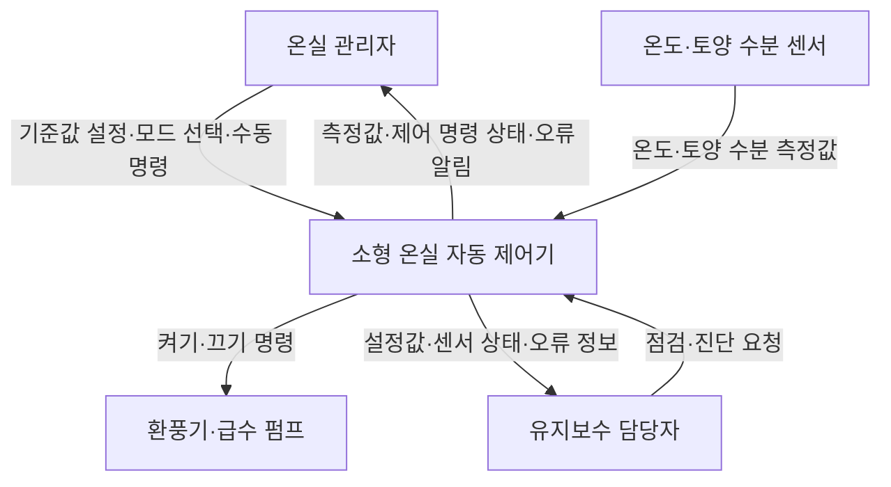

이 과제는 **제어기 하나를 정한 뒤, 무엇을 개발하고 누구와 연결되며 얼마나 많은 작업이 필요한지 정의하는 과제**입니다.

아래는 **「소형 온실 자동 제어기 개발 프로젝트」**를 주제로 작성한 과제 예시입니다. 교수님이 대상 제어기를 따로 지정했다면 주제를 바꿔야 합니다. 인원·기간·예산·성능 수치는 **과제 작성을 위한 계획 가정**이며, 실제 조사나 구현 결과는 아닙니다.

---

**과제 1. 프로젝트 관리 — 소형 온실 자동 제어기 개발**

- 과목: 소프트웨어공학
- 이름: 백재열
- 학번: 본인 학번 입력
- 프로젝트명: 소형 온실 자동 제어기 개발

**1단계. 대상 제어기 선택**

본 프로젝트의 대상은 **소형 온실의 온도와 토양 수분을 측정하여 환풍기와 급수 펌프를 자동으로 작동시키는 제어기**이다.

사용자가 설정한 기준값과 센서 측정값을 비교하여 온실 환경을 관리한다. 사용자는 현재 상태를 확인하고 자동 제어와 수동 제어를 선택할 수 있다.

| 구분 | 내용 |
|---|---|
| 제어 대상 | 소형 온실 1개 구역 |
| 입력 | 온도, 토양 수분, 사용자 설정값, 수동 조작 명령 |
| 출력 | 환풍기·급수 펌프 작동 명령, 상태 표시, 오류 알림 |
| 제어 장치 | 마이크로컨트롤러 기반 제어 보드 |
| 주변 장치 | 온도 센서, 토양 수분 센서, 환풍기, 급수 펌프 |
| 사용자 조작 | 버튼과 소형 표시 장치를 이용한 현장 조작 |

**선정 이유**

온도와 수분이라는 입력, 환풍기와 펌프라는 출력이 명확하여 시스템의 경계를 정의하기 쉽다. 또한 자동 제어, 사용자 조작, 센서 오류 대응을 함께 다룰 수 있어 범위 정의와 이해관계자 분석에 적합하다.

---

**2단계. 프로젝트 범위 정의 — Project Scope Statement**

**① 프로젝트 목표(Objectives)**

본 프로젝트는 사용자가 온실 상태를 확인하고, 설정한 기준에 따라 환풍기와 급수 펌프를 자동으로 제어할 수 있는 시제품 개발을 목표로 한다.

| 목표 | 완료 판단 기준 |
|---|---|
| 환경 상태 확인 | 온도·토양 수분을 2초 주기로 읽고 표시한다. |
| 자동 환기 | 설정한 환풍기 켜짐·꺼짐 기준에 따라 작동한다. |
| 자동 급수 | 수분 부족 시 급수를 시작하고, 종료 기준 또는 최대 작동 시간에 도달하면 정지한다. |
| 사용자 조작 | 자동·수동 모드 전환과 기준값 설정이 가능하다. |
| 오류 대응 | 센서값이 3회 연속 갱신되지 않으면 오류를 표시하고 해당 자동 제어를 중지한다. |
| 검증 | 정상·경계·오류 상황에 대한 필수 테스트가 모두 통과한다. |

위 수치는 초기 요구사항이며, 장치 특성과 실험 결과를 확인한 후 확정한다.

**② 범위 포함 사항(In-Scope)**

| ID | 개발 및 제어할 범위 |
|---|---|
| S1 | 온도·토양 수분 센서 데이터 수집 및 유효성 확인 |
| S2 | 현재 측정값, 제어 모드, 장치 상태 표시 |
| S3 | 온도 기준에 따른 환풍기 자동 제어 |
| S4 | 토양 수분 기준에 따른 급수 펌프 자동 제어 |
| S5 | 자동·수동 모드 전환 및 수동 켜기·끄기 |
| S6 | 제어 기준값 설정과 저장 |
| S7 | 센서 오류, 급수 시간 초과, 재시작 시 출력 정지 처리 |
| S8 | 요구사항·설계 문서, 시험 결과, 사용자 설명서 작성 |

환풍기는 **켜짐 기준과 꺼짐 기준을 다르게 설정**하여 기준 온도 부근에서 반복적으로 켜지고 꺼지는 현상을 줄인다.

수동 모드에서도 급수 최대 작동 시간과 정지 명령은 적용한다. 제어 우선순위는 **정지·오류 보호 → 수동 명령 → 자동 제어**로 정의한다.

**③ 범위 제외 사항(Out-of-Scope)**

- 여러 온실의 통합 관리
- 스마트폰 앱과 인터넷 원격 제어
- 인공지능을 이용한 생육 예측
- 난방·조명·비료 공급 제어
- 온실 구조물 제작과 상용 제품 인증
- 장기간의 작물 생육 및 수확량 검증

**④ 주요 산출물**

프로젝트 범위 정의서, 시스템 문맥도, 이해관계자 분석표, 요구사항 및 설계 문서, 제어기 시제품, 시험 결과서, 사용자 설명서를 산출한다.

---

**3단계. 시스템 문맥도 및 이해관계자 분석**

**① 시스템 경계**

대상 시스템에는 **제어 보드, 제어 소프트웨어, 버튼, 표시 장치, 설정 저장 기능**을 포함한다.

센서와 구동 장치는 연결 및 시험 대상이지만, 문맥도에서는 제어기와 정보를 주고받는 외부 장치로 표현한다. 센서나 펌프 자체의 설계·제작은 범위에서 제외한다.

**② 시스템 문맥도(Context Diagram)**

문맥도는 내부 모듈 구조보다 **대상 시스템과 외부 요소 사이의 정보 흐름**을 나타낸다. 별도의 작동 확인 센서를 포함하지 않으므로, 화면의 장치 상태는 실제 회전·급수 여부가 아닌 **제어 명령 상태**를 의미한다.

**③ 이해관계자 분석 — 사용자 측면**

| 이해관계자 | 역할 및 관심 사항 | 주요 요구사항 | 반영 방법 |
|---|---|---|---|
| 온실 관리자 | 일상적인 온실 관리 | 상태를 쉽게 확인하고 필요할 때 직접 조작 | 측정값 표시, 모드 전환, 수동 제어 |
| 온실 소유자 | 운영 비용과 관리 효율 | 예산 내 개발, 불필요한 작동 방지 | 범위 제한, 급수 시간 제한 |
| 유지보수 담당자 | 고장 점검과 복구 | 오류 원인 및 설정값 확인 | 진단 정보와 점검 설명서 제공 |
| 교수자·평가자 | 과제 요구 충족 여부 평가 | 범위·설계·시험의 일관성 확인 | 요구사항과 WBS, 시험 결과 연결 |

온실 관리자는 직접 사용자이며, 소유자는 도입을 판단하는 이해관계자이다. 한 사람이 두 역할을 함께 수행할 수 있다.

---

**4단계. 제약사항 조사**

현재 장치 모델과 실제 수업 일정이 제공되지 않았으므로, 다음은 **초기 제약사항과 확인 계획**이다. 실제 제출 시 확정된 조건이 있다면 해당 값으로 수정한다.

| 구분 | 초기 제약사항 | 확인 방법 및 대응 |
|---|---|---|
| 기간 | 8주 내 완료를 가정 | 제출일 확인 후 필수 기능 중심으로 일정 조정 |
| 인력 | 학생 1명이 수행한다고 가정 | 분석·구현·시험에 필요한 작업시간 확보 |
| 비용 | 부품 예산 상한 10만 원을 가정 | 실제 부품 견적을 확인하고 초과 시 구성 조정 |
| 제어 범위 | 온실 1개 구역, 센서 2종, 구동 장치 2종 | 요구사항과 부품 목록으로 범위 고정 |
| 장치 호환성 | 보드·센서·구동 장치 연결 조건 충족 필요 | 데이터시트의 전압·전류·인터페이스 확인 |
| 측정 신뢰성 | 토양 수분값은 설치 조건에 따라 달라질 수 있음 | 설치 후 보정하고 기준값 결정 |
| 작동 보호 | 펌프의 무제한 연속 작동 방지 필요 | 최대 작동 시간과 재급수 대기 시간 설정 |
| 전원 장애 | 재시작 시 기존 출력이 바로 재개되지 않아야 함 | 초기 출력 정지 후 센서·설정값 확인 |
| 사용 환경 | 물과 습기가 있는 환경을 고려해야 함 | 전자부와 급수부 배치·보호 방법 확인 |
| 시험 자원 | 실제 온실과 장치를 항상 사용하기 어려울 수 있음 | 모의 입력 시험과 실제 장치 시험을 구분하여 기록 |

예산 상한은 실제 구매 가격을 조사한 결과가 아니다. 부품을 정한 뒤 **사양 자료와 견적의 출처·확인 날짜**를 추가해야 한다.

---

**5단계. 프로젝트 규모 산정**

**① 산정 방법**

초기 단계에서는 상세 구현 내용이 확정되지 않았으므로, 주요 기능을 작업 단위로 나누고 필요한 시간을 합산하는 **작업 기반 규모 산정**을 사용한다.

기능 개수만으로 기능점수(Function Point)를 계산했다고 표현하지 않으며, 코드 줄 수 역시 현 단계에서는 확정하지 않는다.

**② 기능 및 장치 규모**

| 항목 | 예상 규모 |
|---|---|
| 주요 기능 묶음 | S1~S7의 7개 기능 묶음 |
| 센서 입력 | 온도·토양 수분 2종 |
| 제어 출력 | 환풍기·급수 펌프 2종 |
| 제어 모드 | 자동·수동 2종 |
| 사용자 화면 | 상태 확인, 설정, 진단의 3개 화면 |
| 관리 구역 | 온실 1개 구역 |

**③ 작업량 산정**

| 주요 업무 | 예상 작업시간 |
|---|---:|
| 프로젝트 관리 및 요구사항 분석 | 12시간 |
| 시스템 및 시험 설계 | 12시간 |
| 구현과 장치 연결 | 26시간 |
| 통합 시험 및 오류 수정 | 18시간 |
| 문서 작성 및 제출 준비 | 12시간 |
| **기본 작업량** | **80시간** |
| 불확실성 예비 시간 — 기본 작업량의 20% | 16시간 |
| **총 예상 작업량** | **96시간** |

학생 1명이 주당 12시간을 투입한다면 다음과 같이 산정된다.

**96시간 ÷ 주당 12시간 = 8주**

이는 계획용 추정치이며 실제 작업시간과 다를 수 있다. 특히 부품 조달과 센서 보정에 따라 일정이 달라질 수 있다.

---

**6단계. 주요 업무 구분 및 WBS 연계**

WBS(Work Breakdown Structure)는 프로젝트 전체 작업을 관리 가능한 작은 단위로 나누는 구조이다. 각 작업에는 완료를 확인할 수 있는 산출물을 연결한다.

**① WBS**

| WBS 코드 | 업무 | 주요 산출물·완료 기준 | 예상 시간 |
|---|---|---|---:|
| 1.0 | **프로젝트 관리 및 요구사항 분석** |  | **12시간** |
| 1.1 | 대상 제어기 선정 및 범위 정의 | 범위 정의서 | 4시간 |
| 1.2 | 이해관계자·제약사항 분석 | 분석표, 문맥도 | 4시간 |
| 1.3 | 규모·일정·WBS 작성 | 프로젝트 계획서 | 4시간 |
| 2.0 | **시스템 및 시험 설계** |  | **12시간** |
| 2.1 | 시스템 구성 및 장치 연결 설계 | 구성도, 연결 계획 | 4시간 |
| 2.2 | 제어 로직·설정·화면 설계 | 제어 규칙과 화면 설계서 | 5시간 |
| 2.3 | 시험 시나리오 설계 | 정상·경계·오류 시험표 | 3시간 |
| 3.0 | **구현과 장치 연결** |  | **26시간** |
| 3.1 | 센서 입력 및 유효성 검사 구현 | 센서 데이터 수집 기능 | 6시간 |
| 3.2 | 자동 제어 및 보호 기능 구현 | 환기·급수·오류 처리 기능 | 10시간 |
| 3.3 | 화면·설정·수동 제어 구현 | 조작 및 설정 저장 기능 | 10시간 |
| 4.0 | **통합 시험 및 오류 수정** |  | **18시간** |
| 4.1 | 기능별 시험 | 기능 시험 결과 | 5시간 |
| 4.2 | 장치 연동·경계·오류 시험 | 통합 시험 결과 | 7시간 |
| 4.3 | 오류 수정 및 재시험 | 수정 기록, 재시험 결과 | 6시간 |
| 5.0 | **문서 작성 및 제출 준비** |  | **12시간** |
| 5.1 | 설계·시험·사용자 문서 정리 | 최종 보고서, 설명서 | 8시간 |
| 5.2 | 시연 및 제출물 점검 | 시연 자료, 제출 체크리스트 | 4시간 |

상위 업무의 시간은 하위 업무 시간의 합계이므로 **중복 합산하지 않는다**. 기본 작업량은 80시간이며, 예비 시간 16시간은 별도로 관리한다.

**② 프로젝트 범위와 WBS 연결**

| 범위 ID | 해당 기능·산출물 | 설계 WBS | 구현 WBS | 검증 WBS |
|---|---|---|---|---|
| S1 | 센서 수집 및 검사 | 2.1, 2.2 | 3.1 | 4.1, 4.2 |
| S2 | 상태 표시 | 2.2 | 3.3 | 4.1 |
| S3 | 환풍기 자동 제어 | 2.2 | 3.2 | 4.1, 4.2 |
| S4 | 급수 펌프 자동 제어 | 2.2 | 3.2 | 4.1, 4.2 |
| S5 | 모드 전환 및 수동 제어 | 2.2 | 3.3 | 4.1, 4.2 |
| S6 | 기준값 설정 및 저장 | 2.2 | 3.3 | 4.1, 4.2 |
| S7 | 오류·시간 제한·재시작 처리 | 2.2 | 3.2 | 4.2, 4.3 |
| S8 | 문서 및 시험 결과 | 1.1~2.3 | 5.1 | 5.2 |

이 표를 통해 **범위에 포함한 기능이 실제 개발 업무와 시험에 빠짐없이 연결되었는지** 확인할 수 있다.

**③ 예상 일정**

| 기간 | 주요 작업 |
|---|---|
| 1주차 | 대상 선정, 범위 정의, 이해관계자·제약 분석 |
| 2주차 | 시스템·제어 로직·시험 설계 |
| 3~5주차 | 센서 입력, 자동 제어, 화면·설정·수동 제어 구현 |
| 6~7주차 | 통합 시험, 오류 수정, 문서 정리 |
| 8주차 | 지연 대응, 최종 재시험, 시연 및 제출 점검 |

---

제출 전에는 **학번, 실제 팀 인원, 제출일까지의 기간, 예산 조건**을 수정하세요. 특히 4단계가 실제 조사 결과를 요구하는 경우에는 선택한 부품의 사양 자료와 견적을 추가해야 합니다.
